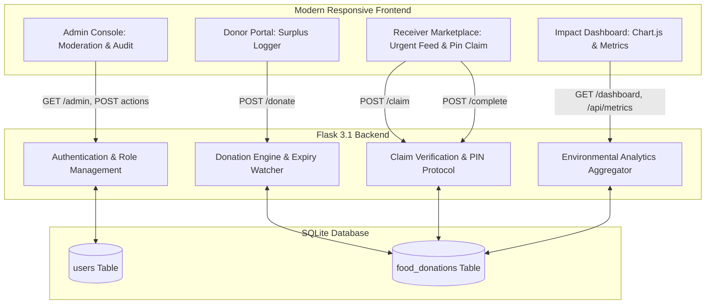
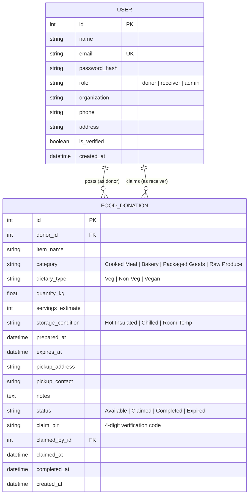

# 🌿 Smart Food Waste Management & Redistribution Platform

> **Academic Evaluation (IA3) Micro-Project**  
> **Domain:** Cloud, Web Engineering & Sustainable Computing  
> **Aligned Goals:** UN Sustainable Development Goal 2 (*Zero Hunger*) & Goal 12 (*Responsible Consumption & Production*)

---

## 1. Academic Metadata & Project Overview

### 1.1 Problem Statement
In institutional environments such as university mess halls, hostel canteens, banquet venues, and urban restaurants, significant quantities of safe, edible prepared food are discarded daily due to demand over-estimation, lack of immediate storage infrastructure, and rigid consumption windows. Simultaneously, local community food banks, night shelters, and welfare NGOs within a 5–15 km radius suffer chronic shortages of cooked meals. 

The primary friction in standard redistribution is **informational asymmetry and time latency**: prepared perishable meals spoil if not claimed and redistributed within strict 2-to-6 hour safety windows, and existing donation workflows lack real-time status tracking, temperature/storage categorization, and secure handover protocols.

### 1.2 Project Objectives (Specific & Measurable)
1. **Reduce Edible Food Waste:** Divert at least 70% of logged institutional surplus from local landfill dumping.
2. **Real-Time Dynamic Urgency Feed:** Classify and prioritize available surplus listings by remaining safe consumption windows (`< 2h Critical`, `2-6h Warning`, `> 6h Safe`) using real-time countdown tickers.
3. **Automated Safety Lockout:** Automatically transition listings to an immutable `Expired` status the second their safe window lapses, preventing foodborne health hazards.
4. **Verified Handover Security:** Eliminate ghost claims via a cryptographic 4-digit Handover PIN generated dynamically upon reservation and verified at physical pickup.
5. **Measurable Carbon & Water Metrics:** Quantify environmental impact via standardized indices:
   $$\text{CO}_2\text{e Avoided (kg)} = \text{Food Diverted (kg)} \times 2.5$$
   $$\text{Water Preserved (L)} = \text{Food Diverted (kg)} \times 1,000$$

### 1.3 Scope and Target Beneficiaries
- **Institutional Donors:** University dining halls, hostel messes, convention centers, catering kitchens.
- **Claimants / Receivers:** Verified hunger-relief NGOs, registered orphanages, night shelters, student volunteer rescue squads.
- **Regulatory / Platform Admins:** University sustainability auditors and food safety moderators.

---

## 2. System Architecture & Database Schema

### 2.1 Architecture Diagram



### 2.2 Entity-Relationship (ER) Schema



---

## 3. Technology Stack

| Layer | Technology | Rationale |
|---|---|---|
| **Backend Engine** | Python 3.12 + Flask 3.1 | Clean, lightweight, modular, zero boiler-plate |
| **ORM / Storage** | SQLAlchemy 2.0 + SQLite 3 | Serverless, zero configuration, instant portability |
| **Styling & UI** | Tailwind CSS + Glassmorphism | Ultra-modern dark UI, high contrast, responsive |
| **Data Visualization** | Chart.js | Real-time doughnut and status bar telemetry |
| **Icons & Micro-UI** | Lucide Icons | Clean SVG feather icons with zero heavy assets |

---

## 4. Setup & Execution Guide

### Step 1: Navigate to Project Directory
```powershell
cd e:\projects\Apps\connected\foodwasteapp
```

### Step 2: Activate the Virtual Environment
```powershell
# Windows PowerShell
.\venv\Scripts\Activate.ps1
# Or Windows Command Prompt
venv\Scripts\activate.bat
```

### Step 3: Install Required Dependencies (If not already installed)
```powershell
pip install -r requirements.txt
```

### Step 4: Seed Database with Realistic Demonstration Data
```powershell
python seed.py
```
*(Creates 5 pre-configured accounts across Donors, NGOs, Admin and 6 varied food listings across Available, Claimed, Completed, and Expired states).*

### Step 5: Start the Server
```powershell
python app.py
```
*Or double click the included `run.bat` file.*

### Step 6: Access the Application
Open your web browser and navigate to:
```
http://127.0.0.1:5000
```

---

## 5. Sample Demonstration Accounts

For instantaneous academic viva evaluation, use the **top banner quick-persona buttons** or these test credentials:

| Persona | Role | Email | Password |
|---|---|---|---|
| **Campus Central Mess (Hostel A)** | Donor | `donor@campus.edu` | `donor123` |
| **Hope Community Shelter & Food Bank** | Receiver (NGO) | `shelter@hope.org` | `receiver123` |
| **Prof. K. Venkatesh (Moderator)** | Admin | `admin@foodwaste.org` | `admin123` |

---

## 6. IA3 3-Minute Demonstration Script (For Evaluator Walkthrough)

- **Minute 0:00 – 0:45: The Problem & Live Marketplace (`/feed`)**
  - Point to the live countdown tickers on the cards (e.g. `1h 35m left`).
  - Demonstrate urgency sorting: items closest to expiration bubble to the top.
  - Highlight the veg/non-veg indicator, storage requirements (`Hot Insulated >60°C`), and CO2 prevention counter.
  - Filter by "Available Now" and "Critical (<2h)" to prove real-time query filtering.

- **Minute 0:45 – 1:30: Logging Surplus with Live Preview (`/donate`)**
  - Switch to **Donor** via the top quick switcher bar.
  - Navigate to **"Donate Food"**.
  - Type in a new listing: *"50 Packets Vegetable Pulao"*, enter `20 kg`.
  - Show the examiner how the **interactive preview card** auto-calculates servings (`~44 meals`) and CO2 emissions prevented (`50 kg CO2e`).
  - Click **"Publish Donation"** and see it immediately appear at the top of the feed.

- **Minute 1:30 – 2:15: Claiming & Secure Handover PIN (`/feed`)**
  - Switch to **Hope Shelter (Receiver / NGO)** via the top bar.
  - Click **"Claim for Distribution"** on an available item.
  - Show the examiner that a unique **4-digit Handover PIN** (e.g., `7842`) is generated.
  - Demonstrate the verification form: entering the PIN locks in the handover and transitions status to `Completed`.

- **Minute 2:15 – 3:00: Impact Telemetry & Admin Governance (`/dashboard` & `/admin`)**
  - Navigate to **"Impact Dashboard"**: explain the cumulative food diverted (kg), meals saved, and CO2 emissions avoided.
  - Show the dynamic Chart.js doughnut chart breaking down categories (Cooked meals vs Bakery).
  - Open **"Admin Console"**: show institutional verification toggles and listings audit table.

---

## 7. Viva Q&A Guide (Examiner Anticipated Questions & Answers)

### Q1: How does your platform handle food safety and legal liability if donated food spoils?
**Answer:** The system implements a three-tier safety framework:
1. **Automated Expiry Lockout:** When `datetime.now() > expires_at`, the platform automatically marks the item `Expired` and blocks claims.
2. **Cold-Chain & Storage Metadata:** Donors must specify storage conditions (Hot Insulated `>60°C`, Chilled `4°C`, or Room Temp). Receivers are informed of storage requirements prior to claim.
3. **Handover Verification:** The 4-digit PIN protocol establishes digital chain-of-custody, logging the exact timestamp when responsibility transitions from donor to receiver.

### Q2: What prevents multiple NGOs from racing to claim the same food listing simultaneously?
**Answer:** In the database layer, transactions utilize atomic status transitions. When a claim request is received, the backend executes an isolated lookup verifying `status == 'Available'`. If another thread has committed a claim, subsequent requests fail validation and return an alert message. In production PostgreSQL/MySQL, this is further protected with row-level locks (`SELECT FOR UPDATE`).

### Q3: How was the CO₂ emissions avoidance metric derived?
**Answer:** We follow the standard environmental index benchmarked by the Food and Agriculture Organization (FAO) and UNEP: **1 kg of discarded solid food waste contributes approximately 2.5 kg of CO₂ equivalent emissions** when decomposing anaerobically in landfills (producing methane $CH_4$, which has 28x the global warming potential of carbon dioxide).

### Q4: How could this platform scale to city-wide food redistribution?
**Answer:** 
1. **Geospatial Proximity Sorting:** Incorporate PostGIS or Haversine formula to sort feed items based on road distance between donor and NGO GPS coordinates.
2. **Push Notifications:** WebSockets or Firebase Cloud Messaging (FCM) to dispatch immediate alerts to shelters within a 5 km radius when high-urgency cooked food is logged.
3. **Volunteer Last-Mile Delivery:** Integrate third-party micro-delivery APIs (e.g. Dunzo/Uber Direct) for NGOs lacking dedicated transport vehicles.
# food-waste-redistribution-system

