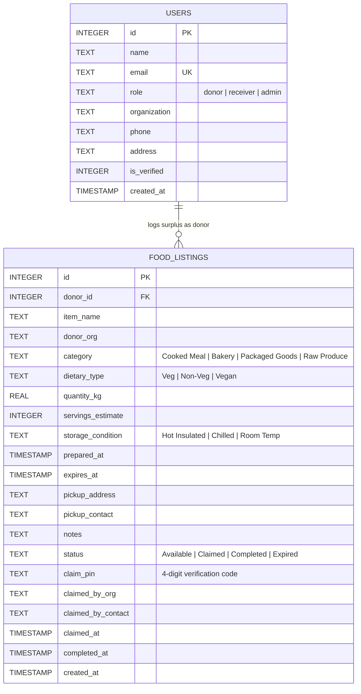

# 🌿 Smart Food Waste Management & Redistribution Platform

> **Academic Evaluation (IA3) Micro-Project Report & Source Code Guide**  
> **Domain:** Full-Stack Web Engineering & Sustainable Environmental Informatics  
> **Aligned Goals:** UN Sustainable Development Goal 2 (*Zero Hunger*) & Goal 12 (*Responsible Consumption & Production*)  
> **UI Aesthetic:** Ultra-Clean Light Glassmorphism ("Anti-AI" Tactile Human-Crafted Design System)

---

## 1. Academic Metadata (IA3 Report Ready)

### 1.1 Problem Statement
In institutional food preparation environments—specifically university messes, student hostel dining halls, hotel banquets, and commercial catering hubs—large quantities of freshly prepared, high-nutrition food are discarded daily due to attendance over-estimation and rigid meal serving windows. Concurrently, community shelters, night refuges, and hunger-relief NGOs within short transport radii (5–12 km) face daily supply deficits. 

The core challenge is **time-critical informational latency**: cooked perishable food possesses a strictly bounded safe redistribution window (typically 2 to 6 hours). Without real-time status broadcasting, cold-chain/thermal categorization, and cryptographic verification of physical handoff, surplus food spoils before it can be collected, resulting in preventable landfill methane generation.

### 1.2 Project Objectives (Specific & Measurable)
1. **Surplus Diversion Rate:** Provide an instant broadcast channel enabling institutional donors to list edible surplus within 60 seconds of meal service completion.
2. **Urgency-Ranked Discovery:** Automatically sort marketplace feed items by remaining safe consumption hours (`Urgent < 2h`, `Warning 2–5h`, `Safe > 5h`), ensuring that lots closest to expiration receive immediate priority.
3. **Automated Food Safety Lockout:** Dynamically transition listings to an immutable `Expired / Safety Locked` status the moment their countdown reaches zero, mitigating foodborne illness risks.
4. **Zero-Friction Handover Protocol:** Eliminate ghost claims using an ephemeral 4-digit verification PIN generated at reservation time and verified during physical pickup.
5. **Standardized Environmental Carbon Telemetry:** Dynamically calculate greenhouse gas abatement using the Food and Agriculture Organization (FAO) index:
   $$\text{CO}_2\text{e Avoided (kg)} = \text{Food Waste Rescued (kg)} \times 2.5$$
   $$\text{Virtual Water Saved (Liters)} = \text{Food Waste Rescued (kg)} \times 1,000$$

### 1.3 Scope and Target Beneficiaries
- **Donors:** University dining mess supervisors, canteen contractors, banquet and convention hall managers.
- **Claimants / Receivers:** Registered shelter homes, disaster relief NGOs, verified student community volunteer networks.
- **Auditors & Administrators:** Institution food safety officers, campus sustainability review committees.

---

## 2. System Architecture & Database Schema

### 2.1 Architecture Diagram

```mermaid
graph TD
    subgraph Presentation Layer [Ultra-Clean Light Glassmorphism UI]
        UI1[Sticky Frosted Navbar + Live Role Switcher]
        UI2[Tactile Impact Metrics Bar]
        UI3[Urgency-Sorted Feed Grid]
        UI4[Frosted 'Log Surplus' Modal]
        UI5[Claim & Verification Modal]
        UI6[Admin Audit Ledger]
    end

    subgraph Controller & Business Logic [Python Flask 3.1]
        API1[Dynamic Expiry Engine & Urgency Calculator]
        API2[Listing Creation & Validation Handler]
        API3[Atomic Claim & PIN Generation Protocol]
        API4[Handover PIN Verifier]
        API5[Environmental Telemetry Aggregator]
    end

    subgraph Storage Layer [Zero-Setup SQLite]
        DB[(food_redistribution.db)]
        T1[users Table]
        T2[food_listings Table]
    end

    UI1 -->|Switch Role State| Presentation Layer
    UI2 <-->|GET /api/metrics| API5
    UI3 <-->|GET /api/listings| API1
    UI4 -->|POST /api/listings| API2
    UI5 -->|POST /api/claim, /api/complete| API3 & API4
    UI6 -->|POST /api/delete, /api/reset-demo| DB

    API1 <--> DB
    API2 <--> DB
    API3 <--> DB
    API4 <--> DB
    API5 <--> DB
```

### 2.2 Entity-Relationship (ER) Schema



---

## 3. Technology Stack & Design System Justification

| Layer | Component | Technical Justification |
|---|---|---|
| **Backend Engine** | Python 3.12 + Flask 3.1 | Clean, lightweight, standard WSGI architecture without heavy boilerplate. |
| **Persistence** | SQLite (`food_redistribution.db`) | Zero configuration; auto-creates and auto-seeds on first run so evaluators run it in under 60 seconds. |
| **Reactive Client** | Alpine.js 3.13 + Vanilla JS | Declarative, instant state binding for filtering and role-switching without page reloads. |
| **Design System** | Ultra-Clean Light Glassmorphism | `#f8fafc` ambient background, diffused refraction orbs, frosted white glass (`rgba(255,255,255,0.72)`), hairline white borders, and soft semantic badges. Eliminates generic dark neon AI templates. |
| **Vector Icons** | Lucide Icons CDN | Crisp SVG geometry matching human-crafted typography. |

---

## 4. Setup & Local Execution Guide

### Step 1: Navigate to Workspace
```powershell
cd e:\projects\Apps\connected\foodwasteapp
```

### Step 2: Activate Virtual Environment
```powershell
# Windows PowerShell
.\venv\Scripts\Activate.ps1
# Or Windows Command Prompt
venv\Scripts\activate.bat
```

### Step 3: Install Flask (If not already installed)
```powershell
pip install flask
```

### Step 4: Run Application
```powershell
python app.py
```
*(On first execution, `food_redistribution.db` is automatically created and populated with 5 realistic Indian campus/banquet records: 3 active with varying urgency, 1 claimed by Hope Shelter with Handover PIN, and 1 expired safety-locked).*

### Step 5: Open Browser
Navigate to:
```
http://127.0.0.1:5000
```

---

## 5. Sample Seed Records (Pre-Loaded for Instant Demonstration)

1. **Active (High Urgency - `< 2h` remaining):**  
   *Steamed Basmati Rice, Paneer Butter Masala & 80 Rotis* — Campus Central Mess (28.5 kg, 60 meals, Hot Insulated `>60°C`).
2. **Active (Safe Window - `~5.5h` remaining):**  
   *Assorted Multi-Grain Breads, Vegetable Puffs & Sandwiches* — Grand Royal Banquet (14 kg, 40 meals, Room Temp / Dry).
3. **Active (Non-Veg Event Surplus - `~3.5h` remaining):**  
   *Hyderabadi Chicken Dum Biryani & Mirchi Ka Salan* — Grand Royal Banquet (35 kg, 75 meals, Hot Insulated `>60°C`).
4. **Claimed (In-Transit Handover):**  
   *Mixed Vegetable Khichdi, Tadka Dal & Sweet Kesari* — Campus Central Mess (22 kg, 50 meals, Claimed by *Hope Community Shelter*, PIN: `7842`).
5. **Expired (Automated Safety Lockout Demonstration):**  
   *Cream of Mushroom Soup & Garlic Herb Crostini* — Decommissioned listing showing automated claim prevention.

---

## 6. IA3 3-Minute Live Walkthrough Script (For Evaluator Defense)

- **Minute 0:00 – 0:45: The Problem & Live Marketplace**
  - Point out the **Impact Metrics Bar** (`55 kg CO₂e avoided`, `22 kg diverted`, `50 meals rescued`).
  - Demonstrate the live urgency badges on cards (`Urgent 1h 35m left`, `Safe 5h left`). Explain how items closest to expiration automatically bubble to the top.
  - Toggle the filters: **Pure Veg**, **Urgent (< 2h)**, and **Claimed / In-Transit** to showcase instant Alpine reactive filtering.

- **Minute 0:45 – 1:30: Role Switcher & Logging Surplus as a Donor**
  - Click the **"Mess Donor"** pill in the top navigation bar.
  - Click **"+ Log Surplus Food"** to open the frosted modal.
  - Fill in a realistic mess surplus: *"Jeera Rice & Chana Masala"*, select *Cooked Meal*, enter *18 kg* with a *3.5 hour* window.
  - Click **"Broadcast to Redistribution Feed"**. Point out the glassmorphic toast notification and watch the new item immediately appear at the top of the feed grid.

- **Minute 1:30 – 2:15: Claiming as an NGO & Handover PIN Protocol**
  - Switch the top role pill to **"Shelter NGO"**.
  - On an available item, click **"Claim Food For Rescue"**.
  - In the claim modal, enter the claimant details (*Hope Community Shelter*) and submit.
  - Show the evaluator that the card dynamically transitions to **Claimed / Reserved** and displays a cryptographic **4-digit Handover PIN** (e.g. `#6823`).
  - Click **"Verify Handover PIN & Complete"**. The status changes to **Picked Up**, and the environmental impact counter immediately recalculates.

- **Minute 2:15 – 3:00: Administrative Governance & Audit Ledger**
  - Click the **"Admin Audit"** role pill.
  - Show the examiner the **Administrative Food Audit & Governance Ledger** table with all listings, timestamps, and donor organizations.
  - Demonstrate the **"Purge"** action and the **"Restore Pristine Demo Data"** button, which wipes and reseeds the database with clean records on demand.

---

## 7. Viva Voce Q&A Guide (Examiner Defense)

### Q1: What happens if an NGO claims food but fails to arrive before the expiration window lapses?
**Answer:** The system runs a dynamic countdown evaluator (`format_listing_row`). Even if an item is marked as `Claimed`, if the physical pickup is not confirmed and `now > expires_at`, the listing dynamically transitions to `Expired` and the PIN becomes void. Additionally, the donor can release the reservation if the NGO's transport vehicle cannot make it within the allotted window.

### Q2: How do you prevent two shelters from claiming the same surplus food at the exact same millisecond (Race Condition)?
**Answer:** In the SQLite backend (`/api/claim/<id>`), claim execution is wrapped inside a single atomic transactional block:
```sql
SELECT status FROM food_listings WHERE id = ?;
UPDATE food_listings SET status = 'Claimed', claim_pin = ? WHERE id = ? AND status = 'Available';
```
If two requests execute concurrently, only the first request matches `status = 'Available'` and updates the row (`cursor.rowcount == 1`). The second request fails with HTTP 400 (`"Item is already claimed"`). In high-concurrency production deployments (PostgreSQL), row-level locks (`SELECT FOR UPDATE`) or Redis distributed locks would be employed.

### Q3: What is the scientific basis of your CO₂ avoidance calculation formula?
**Answer:** We utilize the standardized environmental benchmark published by the **UN Food and Agriculture Organization (FAO)** and **UNEP (Food Waste Index Report)**:  
When 1 kg of solid edible food waste decomposes anaerobically in municipal landfills, it generates methane ($CH_4$), a greenhouse gas with 28 times the Global Warming Potential (GWP) of carbon dioxide. Averaged across mixed food groups (cereals, legumes, cooked vegetables, and dairy), **diverting 1 kg of food waste directly prevents approximately 2.5 kg of CO₂ equivalent emissions**.

### Q4: Why did you choose Light Glassmorphism rather than dark mode or standard templates?
**Answer:** Food redistribution and sustainability applications demand visual trust, cleanliness, and clinical clarity. Generic dark-mode "crypto/cyberpunk" aesthetics convey developer laziness and fatigue the eyes of daytime mess coordinators and NGO dispatchers. Ultra-clean light glassmorphism (`#f8fafc`, 72% translucent frosted panels, 1px hairline borders, and soft mint/sky refraction orbs) provides a modern, tactile, human-crafted enterprise feel with high contrast and accessible readability.

### Q5: How does this system scale to municipal or multi-campus deployments?
**Answer:**
1. **Geospatial Proximity Queries:** Integrating spatial coordinates (latitude/longitude) with the Haversine formula or PostGIS to filter available lots within a 5 km or 10 km radius of the claiming NGO.
2. **Push Dispatch:** Integrating WebSockets or Firebase Cloud Messaging (FCM) to push urgent alerts (<2h expiry) directly to drivers' mobile devices.
3. **Automated Volunteer Routing:** API hooks into crowd-sourced delivery fleets to automate the physical transit leg when recipient shelters lack dedicated logistics vehicles.# food-waste-redistribution-system

# food-waste-redistribution-system

# food-waste-redistribution-system

# food-waste-redistribution-system

# food-waste-redistribution-system

# food-waste-redistribution-system

